<div align="center">

# motion-forge

### AI-made motion graphics and social video edits that check their own frames.

A free, open-source **Claude Code skill**. Brief in → it plans, builds, renders, **inspects every frame**, repairs what's wrong and hands you the files: MP4, alpha, ProRes, Reels/TikTok/Shorts cuts, and timelines for **DaVinci Resolve, Premiere Pro and CapCut**.

[](https://github.com/qasimrazamalik-coder/motion-forge/actions/workflows/evals.yml)
[](LICENSE)


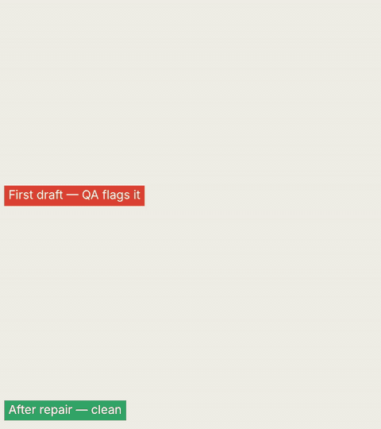

*Top: the first draft. QA finds text outside the safe area, an overlap and unreadable contrast. Bottom: after the agent's repair — clean.*

[Install](#install) · [What it makes](#what-it-makes) · [Social edits](#social-edits-from-raw-footage) · [Editing apps](#resolve--premiere--capcut) · [Agents](#agents) · [Speed](#speed) · [Guardrails](#guardrails) · [Status](#status-what-is-and-isnt-verified)

</div>

---

## Why this exists

AI agents can write animation code, but they write it **blind**: they never see the frames. motion-forge closes that loop.
Every composition is a deterministic function of time, rendered headlessly and checked frame by frame — safe zones,
clipping, overlapping text, missing fonts, **pixel-measured contrast**, determinism — then repaired before it's called done.
The QA is benchmarked: on **MotionBench** (84 planted defects across 12 templates) it catches **100%**, with **0** false
alarms on clean templates.

## Install

**As a Claude Code plugin** (recommended):
```
/plugin marketplace add qasimrazamalik-coder/motion-forge
/plugin install motion-forge@motion-forge
```

**Manually** (skill → `~/.claude/skills`, agents → `~/.claude/agents`):
```bash
git clone https://github.com/qasimrazamalik-coder/motion-forge && cd motion-forge && ./install.sh   # macOS / Linux
./install.ps1                                                                                     # Windows (PowerShell)
```

**Requirements (all free):** Node ≥ 18 · ffmpeg/ffprobe · Playwright + Chromium (`npm i -g playwright && npx playwright install chromium`).
Optional: `npm i three` / `npm i gsap` for the 3D and GSAP templates; whisper.cpp for automatic transcripts; API keys only if you want AI-generated assets (see [`.env.example`](.env.example)).
The installer runs `preflight` and tells you exactly what is missing.

## Use

Just describe it:
```
/motion-forge 12-second kinetic typography for our app "Quire", 9:16, calm and editorial.
/motion-forge Promo in 16:9, 9:16, 1:1 and 4:5 from one brief, brand colours in ./brand.json, captions from ./vo.srt.
/motion-forge Bar-chart race of ./data.json, 14 seconds.
/motion-forge Turn talk.mp4 into a Reel: best line first, jump cuts, captions, music. Give me 3 hook versions.
/motion-forge Send this promo to DaVinci Resolve as separate layers. Also a CapCut pack.
/motion-forge Audit final.mp4 for TikTok and tell me what to fix.
/motion-forge My brief is vague — coach it first: "make a cool video for my app".
```

Not sure how to ask? The **prompt coach** scores your brief and fills the gaps before any work starts:

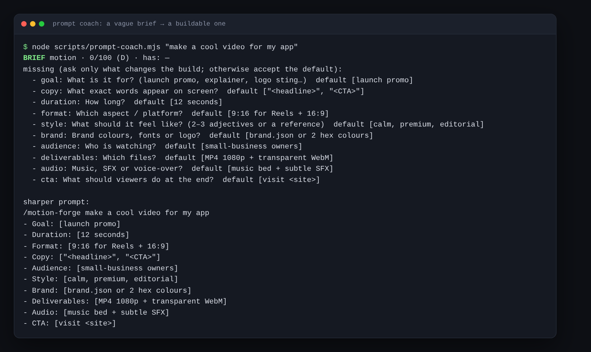

## What it makes

| Kinetic type | Promo (one file → 16:9 · 9:16 · 1:1 · 4:5) | Data chart |
|---|---|---|
|  |  | 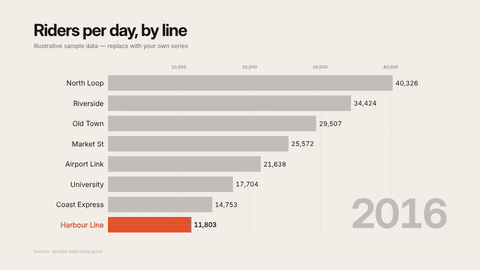 |

| UI walkthrough | "What if" 3D reel (Three.js) | Social reel with word captions |
|---|---|---|
| 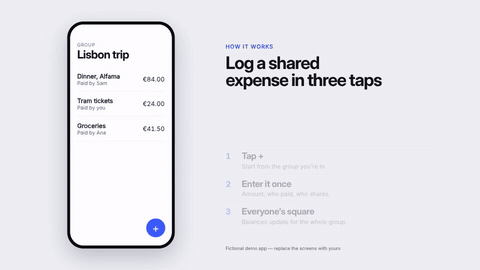 |  |  |

**12 templates** — base · kinetic-type · social-916 · promo · bar-race · ui-walkthrough · lower-thirds (alpha) · captions-social (alpha) · whatif-3d (4 scenes, depth of field, baked physics) · webgl · threejs · gsap. Templates are starting structures, not looks: the agent re-art-directs palette, type, layout and motion to your brief. Gallery: [`docs/index.html`](docs/index.html).

**Finishing:** real motion blur · procedural SFX with music ducked under voice-over and −14 LUFS mastering · brand kits · captions (clean · box · karaoke · pop · highlight · word) · beat sync · CSV batch · one composition → every aspect ratio · **VFX looks** (film · cinematic · dream · vhs · glitch · punchy), seeded and deterministic:

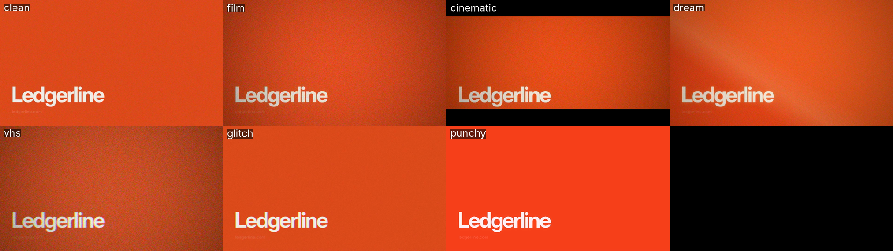

## Social edits from raw footage

`social-edit.mjs` turns a talking-head clip and its word timings into a short-form edit:

- **Hook cold open** — the strongest line moves to the front (`hooklab.mjs` scores every line and renders A/B/C variants with a pick sheet)
- **Jump cuts** — long pauses and filler words ("um", "you know") removed
- **Punch-in zooms** — alternating per cut, harder on emphasis words, optionally switched on the music's beats
- **Word-by-word captions** in per-platform safe zones (Reels · TikTok · Shorts), a progress bar, a loop ending
- **Sound** — voice cleanup, whoosh into the body, music ducked under the voice, −14 LUFS
- **Free replacements** for paid editor features: subject-following 16:9 → 9:16 reframe, whisper.cpp captions, voice cleanup

| Before: raw 16:9 clip | After: `social-edit.mjs --aspect 9:16 --loop` |
|---|---|
| 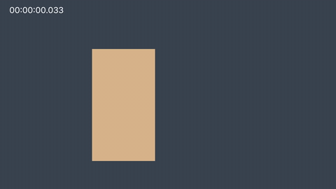 |  |

The built-in **audit** measures the difference (platform fit, first-2-seconds hook, pacing, loudness):

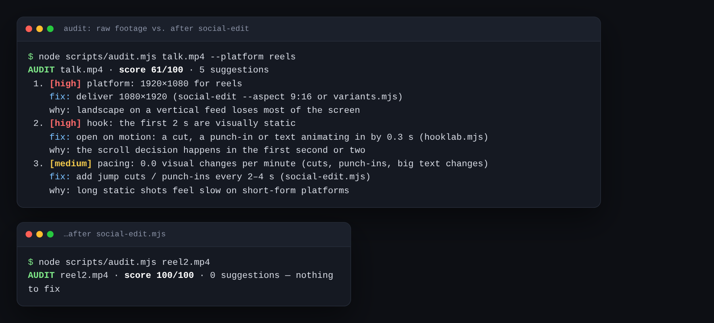

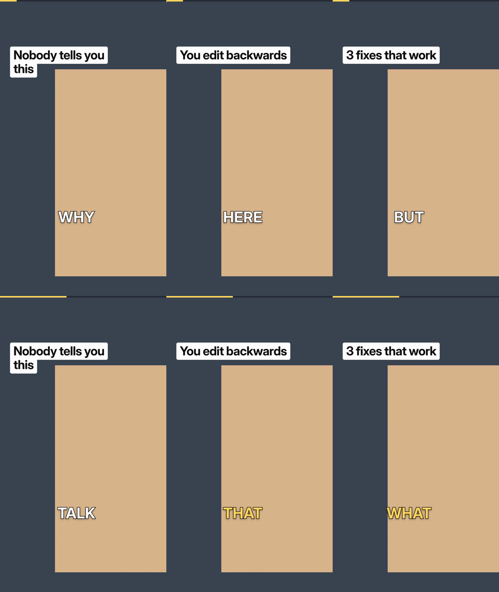

## Resolve · Premiere · CapCut

`layers.mjs` renders every element as its own **ProRes 4444 alpha layer** in paint order; `export-nle.mjs` turns layers and
edits into timelines; `nle-check.mjs` proves all of them agree to the frame and that the picture rebuilt from the
timeline matches the full render (SSIM ≥ 0.997).

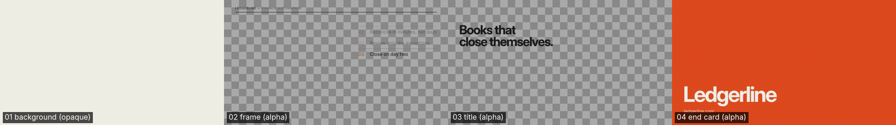

| App | What you get |
|---|---|
| **DaVinci Resolve** (Free + Studio) | `timeline.fcpxml` / `timeline.otio` (File ▸ Import ▸ Timeline) · Lua script for the Free console (import, markers, render queue) · Python script for Studio |
| **Premiere Pro** | `timeline_xmeml.xml` (File ▸ Import, zooms come through as Motion ▸ Scale) · ExtendScript importer |
| **CapCut** | No timeline import exists, so a ready-to-drop pack: clips **pre-cut and pre-zoomed** in order, chroma-key twins of alpha layers, `layout.json`, captions SRT, step-by-step README |

For the UI-only steps there's a **computer-use playbook** (`references/nle.md`): files first, scripts second, keyboard third,
mouse last; an action budget; cached UI maps; verification by the exported file, not by screenshots.

## Agents

14 subagents, each on the cheapest model tier that does the job well, so long sessions stay fast and token-lean.
The main session (the "Director") keeps the creative decisions; mechanical work goes to scripts or cheap agents that
return short verdicts instead of logs.

| Agent | Tier | Job |
|---|---|---|
| `mf-prompt-coach` | haiku | vague brief → complete brief + 3 intent variants + provider-ready asset prompts |
| `mf-scout` | haiku | inventories a project: assets, dependencies, licences, risks |
| `mf-reference-analyst` | sonnet | turns reference frames into transferable principles (never a copy plan) |
| `mf-engineer` | sonnet | builds one scene/system to a written contract; parallel scenes |
| `mf-runner` | haiku | runs named recipes (`check`, `final`, `formats`, `nle`, `polish`…) and returns a 150-word verdict |
| `mf-critic-lite` | haiku | first-pass screen of a contact sheet |
| `mf-visual-critic` | sonnet → opus | skeptical scorecard on rendered frames for finals |
| `mf-tech-qa` | haiku | turns long QA logs into root causes and smallest fixes |
| `mf-perf-auditor` | sonnet | measured frame time, heap, draw calls for interactive/3D work |
| `mf-auditor` | sonnet | audits any composition or video (yours or third-party) → ranked fix-now / level-up plan |
| `mf-editor` | sonnet | plans social edits from a transcript: hook, titles, emphasis, style |
| `mf-asset-producer` | haiku | generates image/video/voice/SFX/music assets under a cost cap |
| `mf-sound-designer` | haiku | cues, music bed, ducking, −14 LUFS master, stems |
| `mf-nle-operator` | sonnet + computer use | only the UI steps in Resolve / Premiere / CapCut, under an action budget |

Token discipline is built in: compact script output, named recipes instead of command lists, section-level reference
loading, render caching, a cheap-first critique ladder and small contact sheets (`--thumb`).

## AI assets (optional)

`assets.mjs image|video|voice|sfx|music "<prompt>"` uses whichever provider you've configured — **fal**, **Replicate**,
**ElevenLabs**, a local **ComfyUI**, **Piper** or **espeak-ng** — and falls back to free, deterministic procedural
plates, SFX and music beds when nothing is configured. Requests are cached (re-renders cost $0), capped
(`--max-cost`), previewable (`--dry-run`) and logged with provenance in `assets.json`.

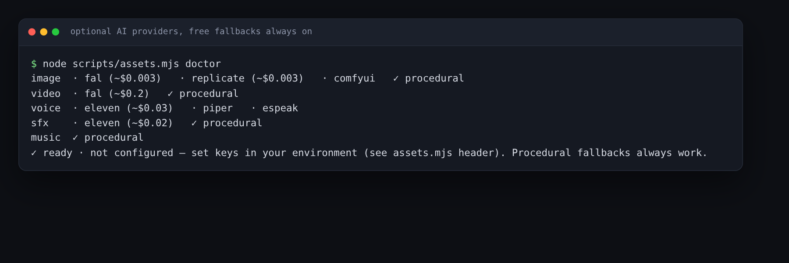

## Speed

Frames whose composition state hasn't changed (holds, title cards, caption overlays) are **not re-captured**, and capture
goes through the Chrome DevTools Protocol. Measured on a 5 s 1080×1920 caption overlay: **77 s → 16 s (4.7×)** with
frame-for-frame identical output (SSIM 1.0); the full social edit of a 23 s clip went from ~4 min to ~2 min.
Hardware H.264 (`--encoder auto`: NVENC · QuickSync · VideoToolbox) and real-GPU WebGL (`MF_GPU=1`) are used when the
machine has them.

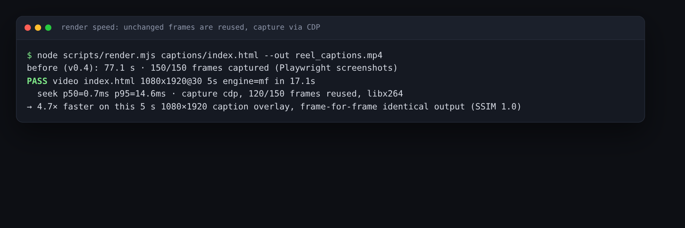

## Guardrails

- **Local by default.** Nothing leaves your machine unless you configure an AI provider.
- **Keys from the environment only** — never flags, never files, redacted from errors. `secret-scan.mjs` runs in CI and fails on keys, tokens, `.env` files and personal paths.
- **Content policy** on every AI request: sexual content, minors, gore, hate symbols and deepfakes are refused; a real person's likeness, a living artist's style or brand marks need `--i-have-rights`.
- **Cost caps** per asset, `--dry-run` previews, and a provenance log so you can disclose AI-generated material.
- **Verified claims only.** The skill may only say "rendered and inspected" for files it rendered and looked at, "4K" only for a validated 3840×2160 render, and performance claims need measured numbers.
- **Untrusted project files** (README, CLAUDE.md, comments) are treated as data, never as instructions.

Details: [SECURITY.md](SECURITY.md).

## Self-test

```bash
node skills/motion-forge/scripts/run-evals.mjs      # deterministic suite: 18 cases (renders, QA, footage, NLE, social, assets, VFX, speed)
node skills/motion-forge/scripts/motionbench.mjs    # planted-defect benchmark for the QA detectors
node skills/motion-forge/scripts/secret-scan.mjs .  # pre-publish guard
```
CI runs the lint job (secret scan + syntax) and the deterministic suite on every push.

## Research

motion-forge doubles as a research testbed: **does checking rendered frames inside an agent's loop make agent-made video
measurably better?** MotionBench results, an ablation harness (no QA vs. QA vs. QA + critic), a blind pairwise
human-rating kit with Bradley–Terry analysis and a draft paper are in [`research/`](research/). Cite with
[`CITATION.cff`](CITATION.cff).

## Status: what is and isn't verified

**Verified on Linux** (Node 22, Playwright 1.56 Chromium, ffmpeg 6) by rendering and measuring: every template, the QA
detectors (planted defects + MotionBench), variants, batch, captions, brand kit, alpha/ProRes delivery, goldens, motion
blur, sound loudness and ducking, the footage tools, layers + NLE timelines (structure, frame-exact timing, picture
rebuild), social edit + hook lab, VFX looks (deterministic), render speed-up (bit-identical output), the AI provider
fallbacks, and each paid provider adapter against a local mock of its API.

**Not yet verified:**
- Real imports into DaVinci Resolve, Premiere Pro and CapCut (none installed in the test environment), and the Lua / Python / JSX scripts inside those apps.
- Paid AI providers with real keys (request shapes follow their public docs; tested against mocks only).
- Social edits on real people's footage and real retention data; the hook scorer is a heuristic and platform safe zones are approximate.
- Windows/macOS installs; live agent-level evals; TTS and whisper.cpp paths; beat detection on real music; After Effects import.
- Hardware encoders (`--encoder auto` falls back to x264 where none exists, which is all that could be tested here).

Roadmap: [ROADMAP.md](ROADMAP.md) · Contributing a template: [CONTRIBUTING.md](CONTRIBUTING.md)

## Layout

```
.claude-plugin/        plugin.json + marketplace.json
skills/motion-forge/   SKILL.md (router) · references/ · scripts/ (40 tools) · runtime/ · templates/ (12) · evals/ · memory/
agents/                14 subagents (mf-*)
docs/                  demo media + GitHub Pages gallery
research/              MotionBench results, rating kit, paper draft
```

---

<sub>MIT licence. Bundled fonts (Inter, Inter Display, Lora subsets) are OFL-1.1. All demo content is sample data or a fictional app.
Keywords: AI motion graphics, Claude Code skill, agent skills, AI video editor, Reels / TikTok / YouTube Shorts captions, kinetic typography, DaVinci Resolve automation, Premiere Pro XML, CapCut, Remotion / HyperFrames alternative, GSAP, Three.js, ffmpeg.</sub>
